# EXAM HALL ALLOCATOR SYSTEM
### A Core Java Mini-Project Report
**Department of Information Technology**  
**Academic Year: 2025–2026 / 2nd Year B.Tech IT**

---

## 1. Title Page

- **Project Title:** Exam Hall Allocator System
- **Domain:** Educational Software & Resource Management
- **Course / Level:** 2nd Year B.Tech – Information Technology
- **Programming Language:** Core Java (JDK 8+)
- **Architecture:** Object-Oriented Programming (OOP) / Console-Based Modular Application

---

## 2. Abstract

Before semester or periodic institutional examinations, examination cell coordinators and administrative staff must manually allocate hundreds or thousands of students to various examination halls and individual benches. The manual allocation procedure is intensely labor-driven, error-prone, and susceptible to critical bottlenecks such as duplicate seating assignments, accidental student omission, hall overcapacity, and delayed publishing of seating notices.

The **Exam Hall Allocator System** is a lightweight, robust, menu-driven Core Java application developed to automate this procedure. By utilizing core Object-Oriented Programming (OOP) principles—namely Encapsulation, Abstraction, and Modular Design—together with Java Collections (`ArrayList`), the system enables administrators to register students, define examination halls with explicit capacities, automatically compute sequential seat allocations (e.g., `A-01`, `B-01`), detect capacity shortages, search for student allocations instantaneously, and output both student-wise and hall-wise seating reports. The application enforces strict data validation to reject invalid inputs and prevent application crashes.

---

## 3. Introduction

Examination management is an integral component of college administration. Every semester, colleges schedule exams across multiple departments, requiring systematic distribution of students into designated classrooms, lecture halls, and laboratories.

In traditional college setups, seating allocation is carried out using spreadsheet software or paper logs. This manual assignment frequently leads to human error:
1. Two students may be assigned the same desk.
2. A hall might be assigned more students than physical seats available.
3. Students and invigilators struggle to trace seating locations on notice boards.

The **Exam Hall Allocator System** demonstrates how fundamental Core Java programming techniques—such as classes, objects, constructors, collections, loops, decision-making constructs, and exception handling—can solve an authentic real-world campus challenge with zero dependencies on third-party frameworks or external databases.

---

## 4. Problem Statement

Manual examination hall seating allocation creates several administrative and operational issues:
- **High Time and Labor Consumption:** Staff spend days manually preparing seating charts.
- **Seat Collisions:** Inadvertent allocation of multiple candidates to identical desk numbers.
- **Capacity Overflow:** Discrepancies between physical desk counts and assigned student counts.
- **Student Omission:** Students left unallocated without immediate detection.
- **Search Latency:** Inability to rapidly locate an individual student's allocated room and bench during an examination morning.

---

## 5. Objectives

The primary objectives of this project are:
1. **Automate Seat Allocation:** Formulate a systematic algorithm to fill examination halls sequentially up to their maximum capacity.
2. **Prevent Duplicate Registrations:** Reject duplicate student register numbers and duplicate hall identifiers.
3. **Capacity Enforcement:** Guarantee that no examination hall receives more students than its configured maximum capacity.
4. **Comprehensive Reporting:** Generate student-wise and hall-wise seating reports.
5. **Real-time Querying:** Provide instant search capability by register number.
6. **Graceful Exception Handling:** Prevent runtime crashes by intercepting invalid non-numeric inputs and invalid numbers.
7. **Educational Clarity:** Keep the source code clean, modular, and easy to explain during a college viva.

---

## 6. Existing System and Its Disadvantages

### Existing System Overview
In the conventional existing system, examination coordinators use physical ledger sheets or manually edited Excel files. A coordinator reviews a roll sheet, handwrites desk numbers on a chalkboard or door chart, and tallies headcounts manually.

### Disadvantages of the Existing System
- **Prone to Human Error:** Mistyped register numbers, missing records, or accidental double bookings.
- **Hall Overflow:** Assigning 35 students to a room with only 30 physical desks.
- **No Automated Capacity Balancing:** Coordinators must manually calculate remaining seats.
- **Poor Searchability:** Finding where a specific candidate is seated requires scanning entire pages of paper notices.
- **Lack of Input Validation:** Spreadsheets accept invalid strings, negative numbers, or empty entries unless complex scripts are written.

---

## 7. Proposed System

The proposed **Exam Hall Allocator System** introduces an in-memory, automated console-based solution designed using Core Java:
- **Automated Sequential Allocation:** Automatically assigns sequential seat numbers (e.g., `A-01`, `A-02`, ..., `B-01`, `B-02`) based on the hall's configured capacity.
- **Strict Validation Rules:** Rejects duplicate register numbers, duplicate halls, empty strings, and non-positive capacities.
- **Overcapacity Protection:** Halts allocation when hall limits are reached and explicitly lists all unallocated students.
- **Instant Student Lookup:** Instant search by student register number showing hall and seat assignment.
- **Hall Occupancy Monitoring:** Live dashboard displaying capacity, occupied seats, and available seats for all halls.
- **Crash-Proof Input Engine:** Uses `Integer.parseInt()` wrapped in `try-catch` blocks to handle unexpected user inputs without terminating the program.

---

## 8. Software and Hardware Requirements

### Software Requirements
- **Operating System:** Windows 10 / 11, Linux (Ubuntu/Debian), or macOS
- **Language / Runtime:** Java Development Kit (JDK 8 or higher: JDK 8, 11, 17, 21)
- **Editor / IDE:** VS Code (with Extension Pack for Java), Eclipse IDE, IntelliJ IDEA, or Command Prompt / PowerShell
- **External Dependencies:** None (Standard Java API only: `java.util.Scanner`, `java.util.ArrayList`, `java.io.PrintWriter`)

### Hardware Requirements
- **Processor:** 1.0 GHz or higher (Intel/AMD x86/x64 or Apple Silicon)
- **RAM:** Minimum 512 MB (2 GB+ recommended)
- **Storage:** Less than 10 MB available hard drive space

---

## 9. System Workflow and Algorithm

### 9.1 Overall Workflow
```
[Start Application]
         │
         ▼
[Display Main Menu (Options 1–8)]
         │
         ├──► 1. Add Student (Validate uniqueness, name, dept)
         ├──► 2. Add Examination Hall (Validate uniqueness, positive capacity)
         ├──► 3. Automatic Seat Allocation (Run sequential seating algorithm)
         ├──► 4. View All Students (Tabular register of all students)
         ├──► 5. View Seating Arrangement (Student-wise & Hall-wise tables)
         ├──► 6. Search Student (Find by Reg No)
         ├──► 7. View Hall Availability (Capacity vs Occupancy dashboard)
         └──► 8. Exit (Terminate gracefully)
```

### 9.2 Automatic Seat Allocation Algorithm

```text
Algorithm: AutomaticSeatAllocation
Input    : studentList (ArrayList of Student), hallList (ArrayList of ExamHall)
Output   : Assigned seats and an Allocation Summary

Step 1 : Check if studentList is empty. If yes, display warning and EXIT.
Step 2 : Check if hallList is empty. If yes, display warning and EXIT.
Step 3 : Clear any prior allocations in both studentList and hallList.
Step 4 : Initialize currentHallIndex = 0.
Step 5 : Initialize allocatedCount = 0.
Step 6 : FOR each student 's' in studentList:
           a. WHILE currentHallIndex < hallList.size() AND hallList[currentHallIndex].isFull():
                Increment currentHallIndex by 1
           b. IF currentHallIndex >= hallList.size():
                BREAK (All halls are full; remaining students cannot be seated)
           c. currentHall = hallList[currentHallIndex]
           d. hallLetter = (char) ('A' + (currentHallIndex % 26))
           e. nextSeatIndex = currentHall.getOccupiedSeats() + 1
           f. seatNumber = format("%c-%02d", hallLetter, nextSeatIndex)
           g. currentHall.assignStudent(s, seatNumber)
           h. Increment allocatedCount by 1
Step 7 : Display Allocation Summary:
           - Total Students
           - Total Capacity
           - Total Allocated
           - Total Unallocated
Step 8 : IF unallocatedCount > 0:
           Display warning and list all students where s.isAllocated() == false
         ELSE:
           Display success message: "All students allocated successfully!"
Step 9 : Return.
```

---

## 10. Flowchart

```mermaid
flowchart TD
    Start([Start Application]) --> Menu[/Display Main Menu/]
    Menu --> InputChoice[/Enter Choice 1 to 8/]
    
    InputChoice --> CheckChoice{Choice?}
    
    CheckChoice -- 1 --> AddStudent[Add Student: Check Duplicates & Non-empty]
    AddStudent --> Menu
    
    CheckChoice -- 2 --> AddHall[Add Hall: Check Duplicates & Capacity > 0]
    AddHall --> Menu
    
    CheckChoice -- 3 --> CheckData{Students & Halls Exist?}
    CheckData -- No --> ErrData[Display Warning] --> Menu
    CheckData -- Yes --> ClearOld[Reset Prior Allocations]
    ClearOld --> LoopStudents[Loop through Students]
    LoopStudents --> CheckHallCap{Current Hall Full?}
    CheckHallCap -- Yes --> NextHall[Move to Next Hall]
    NextHall --> CheckMoreHalls{More Halls?}
    CheckMoreHalls -- No --> Summary[Display Allocation Summary & Unallocated List]
    CheckMoreHalls -- Yes --> AssignSeat[Assign Seat e.g. A-01, B-01]
    CheckHallCap -- No --> AssignSeat
    AssignSeat --> MoreStudents{More Students?}
    MoreStudents -- Yes --> LoopStudents
    MoreStudents -- No --> Summary
    Summary --> Menu
    
    CheckChoice -- 4 --> ViewStudents[Display Tabular Student Register]
    ViewStudents --> Menu
    
    CheckChoice -- 5 --> ViewSeating[Display Student-wise & Hall-wise Tables]
    ViewSeating --> Menu
    
    CheckChoice -- 6 --> SearchStudent[Search Student by Reg No]
    SearchStudent --> Menu
    
    CheckChoice -- 7 --> ViewHalls[Display Hall Capacity, Occupancy & Vacancies]
    ViewHalls --> Menu
    
    CheckChoice -- 8 --> ExitProg([Display Exit Message & Terminate])
    
    CheckChoice -- Invalid --> ErrChoice[Display Error: Please Enter 1-8]
    ErrChoice --> Menu
```



---

## 11. Class Descriptions

The application is structured into four modular classes:

| Class Name | File Name | Primary Responsibility |
| :--- | :--- | :--- |
| **`Student`** | `Student.java` | Model class encapsulating student details: register number, full name, department, allocation flag, assigned hall, and seat number. |
| **`ExamHall`** | `ExamHall.java` | Model class encapsulating examination hall details: hall number, total capacity, and the list of seated students. Provides occupancy calculations. |
| **`Allocator`** | `Allocator.java` | Service / Controller class managing the `ArrayList<Student>` and `ArrayList<ExamHall>`, validating data, running the allocation algorithm, and building formatted reports. |
| **`Main`** | `Main.java` | Presentation / View class containing the `main()` method, console menu loop, `Scanner` input reader, and exception-safe option dispatch. |

### Detailed Class Breakdown:

#### 1. `Student.java`
- **Fields:**
  - `private String regNo`: Student register number.
  - `private String name`: Full name.
  - `private String department`: Academic department (IT, CSE, ECE, etc.).
  - `private boolean isAllocated`: True if seated, false otherwise.
  - `private String allocatedHall`: Name of assigned hall (default: `"Not Assigned"`).
  - `private String seatNumber`: Assigned seat code (default: `"Not Assigned"`).
- **Key Methods:**
  - `Student(...)`: Parameterized constructor.
  - `allocateSeat(String hallNo, String seat)`: Updates hall, seat, and status flag.
  - `resetAllocation()`: Resets allocation state to unassigned.
  - `toString()`: Returns formatted single-line record.

#### 2. `ExamHall.java`
- **Fields:**
  - `private String hallNo`: Unique hall identifier (e.g., `"HALL-1"`).
  - `private int capacity`: Maximum physical seating capacity.
  - `private ArrayList<Student> allocatedStudents`: Dynamic list of students seated in this hall.
- **Key Methods:**
  - `ExamHall(...)`: Parameterized constructor.
  - `getOccupiedSeats()`: Returns `allocatedStudents.size()`.
  - `getAvailableSeats()`: Returns `capacity - allocatedStudents.size()`.
  - `isFull()`: Returns `true` if `occupied >= capacity`.
  - `assignStudent(Student s, String seatNo)`: Enforces capacity boundary and adds student.
  - `clearAllocations()`: Resets all seated students and clears internal list.
  - `printHallStatus()`: Prints hall summary and seated student roster.

#### 3. `Allocator.java`
- **Fields:**
  - `private ArrayList<Student> studentList`: In-memory storage of registered students.
  - `private ArrayList<ExamHall> hallList`: In-memory storage of registered halls.
- **Key Methods:**
  - `findStudent(String regNo)`: Case-insensitive lookup helper.
  - `findHall(String hallNo)`: Case-insensitive hall lookup helper.
  - `addStudent(String regNo, String name, String dept)`: Validates inputs, rejects duplicates, and adds to list.
  - `addHall(String hallNo, int capacity)`: Validates positive capacity, rejects duplicates, and adds hall.
  - `allocateSeats()`: Executes the automated sequential seat allocation algorithm.
  - `viewAllStudents()`: Renders tabular list of all students.
  - `viewSeatingArrangement()`: Renders both student-wise and hall-wise reports.
  - `searchStudent(String regNo)`: Retrieves and prints full allocation details for a student.
  - `viewHallAvailability()`: Prints detailed occupancy metrics across all halls.
  - `loadSampleData()`: Preloads the 5 test students and 2 halls for viva demonstration.
  - `exportSeatingReportToFile(String filename)`: Saves the seating chart to a text file.

#### 4. `Main.java`
- **Fields / Methods:**
  - `main(String[] args)`: Core event loop running the 8-option switch statement.
  - `printMenu()`: Prints the menu banner.
  - Robust input parsing with `Integer.parseInt(scanner.nextLine().trim())` wrapped in `try-catch (NumberFormatException)` to prevent crashes and eliminate the standard `Scanner.nextInt()` newline bug.

---

## 12. Complete Source Code

### File 1: `Student.java`
```java
public class Student {
    private String regNo;
    private String name;
    private String department;
    private boolean isAllocated;
    private String allocatedHall;
    private String seatNumber;

    public Student(String regNo, String name, String department) {
        this.regNo = regNo.trim();
        this.name = name.trim();
        this.department = department.trim().toUpperCase();
        this.isAllocated = false;
        this.allocatedHall = "Not Assigned";
        this.seatNumber = "Not Assigned";
    }

    public String getRegNo() { return regNo; }
    public String getName() { return name; }
    public String getDepartment() { return department; }
    public boolean isAllocated() { return isAllocated; }
    public String getAllocatedHall() { return allocatedHall; }
    public String getSeatNumber() { return seatNumber; }

    public void allocateSeat(String hallNo, String seat) {
        this.allocatedHall = hallNo;
        this.seatNumber = seat;
        this.isAllocated = true;
    }

    public void resetAllocation() {
        this.allocatedHall = "Not Assigned";
        this.seatNumber = "Not Assigned";
        this.isAllocated = false;
    }

    @Override
    public String toString() {
        return String.format("%-10s | %-18s | %-8s | %-12s | %-10s | %-8s",
                regNo, name, department,
                (isAllocated ? "Allocated" : "Unallocated"),
                allocatedHall, seatNumber);
    }
}
```

### File 2: `ExamHall.java`
```java
import java.util.ArrayList;

public class ExamHall {
    private String hallNo;
    private int capacity;
    private ArrayList<Student> allocatedStudents;

    public ExamHall(String hallNo, int capacity) {
        this.hallNo = hallNo.trim().toUpperCase();
        this.capacity = capacity;
        this.allocatedStudents = new ArrayList<Student>();
    }

    public String getHallNo() { return hallNo; }
    public int getCapacity() { return capacity; }
    public ArrayList<Student> getAllocatedStudents() { return allocatedStudents; }
    public int getOccupiedSeats() { return allocatedStudents.size(); }
    public int getAvailableSeats() { return capacity - allocatedStudents.size(); }
    public boolean isFull() { return getOccupiedSeats() >= capacity; }

    public boolean assignStudent(Student student, String seatNo) {
        if (isFull()) {
            return false;
        }
        student.allocateSeat(this.hallNo, seatNo);
        allocatedStudents.add(student);
        return true;
    }

    public void clearAllocations() {
        for (Student s : allocatedStudents) {
            s.resetAllocation();
        }
        allocatedStudents.clear();
    }

    public void printHallStatus() {
        System.out.println("----------------------------------------");
        System.out.println("Hall: " + hallNo);
        System.out.println("Total Capacity: " + capacity);
        System.out.println("Occupied Seats: " + getOccupiedSeats());
        System.out.println("Available Seats: " + getAvailableSeats());
        System.out.print("Assigned Students: ");
        if (allocatedStudents.isEmpty()) {
            System.out.println("None");
        } else {
            System.out.println();
            for (Student s : allocatedStudents) {
                System.out.println("   -> " + s.getRegNo() + " (" + s.getName() + ") - Seat: " + s.getSeatNumber());
            }
        }
    }
}
```

### File 3: `Allocator.java`
```java
import java.io.FileWriter;
import java.io.IOException;
import java.io.PrintWriter;
import java.util.ArrayList;

public class Allocator {
    private ArrayList<Student> studentList;
    private ArrayList<ExamHall> hallList;

    public Allocator() {
        this.studentList = new ArrayList<Student>();
        this.hallList = new ArrayList<ExamHall>();
    }

    public Student findStudent(String regNo) {
        if (regNo == null) return null;
        for (Student s : studentList) {
            if (s.getRegNo().equalsIgnoreCase(regNo.trim())) {
                return s;
            }
        }
        return null;
    }

    public ExamHall findHall(String hallNo) {
        if (hallNo == null) return null;
        for (ExamHall h : hallList) {
            if (h.getHallNo().equalsIgnoreCase(hallNo.trim())) {
                return h;
            }
        }
        return null;
    }

    public boolean addStudent(String regNo, String name, String dept) {
        if (regNo == null || regNo.trim().isEmpty()) {
            System.out.println("[ERROR] Register number cannot be empty!");
            return false;
        }
        if (name == null || name.trim().isEmpty()) {
            System.out.println("[ERROR] Student name cannot be empty!");
            return false;
        }
        if (dept == null || dept.trim().isEmpty()) {
            System.out.println("[ERROR] Department cannot be empty!");
            return false;
        }
        if (findStudent(regNo) != null) {
            System.out.println("[ERROR] Student with Register Number '" + regNo.trim() + "' already exists!");
            return false;
        }
        Student newStudent = new Student(regNo, name, dept);
        studentList.add(newStudent);
        System.out.println("[SUCCESS] Student '" + newStudent.getName() + "' (" + newStudent.getRegNo() + ") added successfully.");
        return true;
    }

    public boolean addHall(String hallNo, int capacity) {
        if (hallNo == null || hallNo.trim().isEmpty()) {
            System.out.println("[ERROR] Hall number cannot be empty!");
            return false;
        }
        if (capacity <= 0) {
            System.out.println("[ERROR] Hall capacity must be a positive integer greater than zero!");
            return false;
        }
        if (findHall(hallNo) != null) {
            System.out.println("[ERROR] Examination Hall '" + hallNo.trim().toUpperCase() + "' already exists!");
            return false;
        }
        ExamHall newHall = new ExamHall(hallNo, capacity);
        hallList.add(newHall);
        System.out.println("[SUCCESS] Hall '" + newHall.getHallNo() + "' with capacity " + capacity + " added successfully.");
        return true;
    }

    public void allocateSeats() {
        if (studentList.isEmpty()) {
            System.out.println("[WARNING] No students registered in the system. Please add students first!");
            return;
        }
        if (hallList.isEmpty()) {
            System.out.println("[WARNING] No examination halls available. Please add halls first!");
            return;
        }

        for (ExamHall hall : hallList) {
            hall.clearAllocations();
        }
        for (Student student : studentList) {
            student.resetAllocation();
        }

        System.out.println("\n--------------------------------------------------");
        System.out.println("       AUTOMATIC SEAT ALLOCATION IN PROGRESS      ");
        System.out.println("--------------------------------------------------");

        int currentHallIndex = 0;
        int allocatedCount = 0;
        int totalCapacity = 0;

        for (ExamHall h : hallList) {
            totalCapacity += h.getCapacity();
        }

        for (Student student : studentList) {
            while (currentHallIndex < hallList.size() && hallList.get(currentHallIndex).isFull()) {
                currentHallIndex++;
            }
            if (currentHallIndex >= hallList.size()) {
                break;
            }

            ExamHall currentHall = hallList.get(currentHallIndex);
            char hallLetter = (char) ('A' + (currentHallIndex % 26));
            int nextSeatIndex = currentHall.getOccupiedSeats() + 1;
            String seatNumber = String.format("%c-%02d", hallLetter, nextSeatIndex);

            currentHall.assignStudent(student, seatNumber);
            allocatedCount++;
        }

        System.out.println("\n===== ALLOCATION SUMMARY =====");
        System.out.println("Total Students Registered : " + studentList.size());
        System.out.println("Total Examination Capacity: " + totalCapacity);
        System.out.println("Students Allocated        : " + allocatedCount);

        int unallocatedCount = studentList.size() - allocatedCount;
        System.out.println("Unallocated Students      : " + unallocatedCount);

        if (unallocatedCount > 0) {
            System.out.println("\n[ALERT] Insufficient Seating Capacity! The following students could not be allocated:");
            for (Student s : studentList) {
                if (!s.isAllocated()) {
                    System.out.println("   - Reg No: " + s.getRegNo() + " | Name: " + s.getName() + " | Dept: " + s.getDepartment());
                }
            }
        } else {
            System.out.println("\n[SUCCESS] All students successfully allocated to examination halls!");
        }
    }

    public void viewAllStudents() {
        if (studentList.isEmpty()) {
            System.out.println("[INFO] No students have been registered yet.");
            return;
        }
        System.out.println("\n==========================================================================================");
        System.out.println("                                REGISTERED STUDENTS LIST                                  ");
        System.out.println("==========================================================================================");
        System.out.printf("%-12s | %-20s | %-12s | %-14s | %-12s | %-10s%n",
                "Reg No", "Student Name", "Department", "Status", "Hall No", "Seat No");
        System.out.println("------------------------------------------------------------------------------------------");

        for (Student s : studentList) {
            System.out.printf("%-12s | %-20s | %-12s | %-14s | %-12s | %-10s%n",
                    s.getRegNo(), s.getName(), s.getDepartment(),
                    (s.isAllocated() ? "Allocated" : "Unallocated"),
                    s.getAllocatedHall(), s.getSeatNumber());
        }
        System.out.println("==========================================================================================");
        System.out.println("Total Registered Students: " + studentList.size());
    }

    public void viewSeatingArrangement() {
        boolean hasAllocatedStudents = false;
        for (Student s : studentList) {
            if (s.isAllocated()) {
                hasAllocatedStudents = true;
                break;
            }
        }
        if (!hasAllocatedStudents) {
            System.out.println("[INFO] No seats have been allocated yet. Please choose Option 3 (Allocate Seats) first.");
            return;
        }

        System.out.println("\n==========================================================================================");
        System.out.println("                        REPORT 1: STUDENT-WISE SEATING ARRANGEMENT                        ");
        System.out.println("==========================================================================================");
        System.out.printf("%-12s | %-20s | %-12s | %-12s | %-10s%n",
                "Reg No", "Student Name", "Department", "Hall No", "Seat No");
        System.out.println("------------------------------------------------------------------------------------------");
        for (Student s : studentList) {
            if (s.isAllocated()) {
                System.out.printf("%-12s | %-20s | %-12s | %-12s | %-10s%n",
                        s.getRegNo(), s.getName(), s.getDepartment(), s.getAllocatedHall(), s.getSeatNumber());
            }
        }
        System.out.println("------------------------------------------------------------------------------------------");

        System.out.println("\n==========================================================================================");
        System.out.println("                         REPORT 2: HALL-WISE SEATING ARRANGEMENT                          ");
        System.out.println("==========================================================================================");
        for (ExamHall hall : hallList) {
            System.out.println("\n>>> EXAMINATION HALL: " + hall.getHallNo() + " (Capacity: " + hall.getCapacity() + ", Occupied: " + hall.getOccupiedSeats() + ")");
            if (hall.getAllocatedStudents().isEmpty()) {
                System.out.println("    [No students allocated to this hall]");
            } else {
                System.out.printf("    %-10s | %-12s | %-20s | %-10s%n", "Seat No", "Reg No", "Student Name", "Dept");
                System.out.println("    ------------------------------------------------------------");
                for (Student s : hall.getAllocatedStudents()) {
                    System.out.printf("    %-10s | %-12s | %-20s | %-10s%n",
                            s.getSeatNumber(), s.getRegNo(), s.getName(), s.getDepartment());
                }
            }
        }
        System.out.println("==========================================================================================");
    }

    public void searchStudent(String regNo) {
        if (regNo == null || regNo.trim().isEmpty()) {
            System.out.println("[ERROR] Search register number cannot be empty!");
            return;
        }
        Student student = findStudent(regNo);
        if (student == null) {
            System.out.println("[RESULT] Student with Register Number '" + regNo.trim() + "' does not exist in the system.");
            return;
        }
        System.out.println("\n----------------- STUDENT DETAILS -----------------");
        System.out.println("Register Number  : " + student.getRegNo());
        System.out.println("Student Name     : " + student.getName());
        System.out.println("Department       : " + student.getDepartment());
        System.out.println("Allocation Status: " + (student.isAllocated() ? "ALLOCATED" : "NOT ALLOCATED"));
        System.out.println("Examination Hall : " + student.getAllocatedHall());
        System.out.println("Assigned Seat No : " + student.getSeatNumber());
        System.out.println("---------------------------------------------------");
    }

    public void viewHallAvailability() {
        if (hallList.isEmpty()) {
            System.out.println("[INFO] No examination halls registered yet.");
            return;
        }
        System.out.println("\n==================================================");
        System.out.println("            EXAM HALL AVAILABILITY REPORT         ");
        System.out.println("==================================================");

        int totalHalls = hallList.size();
        int totalCapacity = 0;
        int totalOccupied = 0;

        for (ExamHall hall : hallList) {
            hall.printHallStatus();
            totalCapacity += hall.getCapacity();
            totalOccupied += hall.getOccupiedSeats();
        }

        System.out.println("----------------------------------------");
        System.out.println("Total Registered Halls : " + totalHalls);
        System.out.println("Total Combined Capacity: " + totalCapacity);
        System.out.println("Total Occupied Seats   : " + totalOccupied);
        System.out.println("Total Remaining Seats  : " + (totalCapacity - totalOccupied));
        System.out.println("==================================================");
    }

    public boolean exportSeatingReportToFile(String fileName) {
        try (PrintWriter writer = new PrintWriter(new FileWriter(fileName))) {
            writer.println("==========================================================================================");
            writer.println("                           EXAM HALL SEATING ARRANGEMENT REPORT                           ");
            writer.println("==========================================================================================");
            writer.printf("%-12s | %-20s | %-12s | %-12s | %-10s%n",
                    "Reg No", "Student Name", "Department", "Hall No", "Seat No");
            writer.println("------------------------------------------------------------------------------------------");
            for (Student s : studentList) {
                if (s.isAllocated()) {
                    writer.printf("%-12s | %-20s | %-12s | %-12s | %-10s%n",
                            s.getRegNo(), s.getName(), s.getDepartment(), s.getAllocatedHall(), s.getSeatNumber());
                }
            }
            writer.println("==========================================================================================");
            writer.println("Generated successfully by Exam Hall Allocator System.");
            System.out.println("[SUCCESS] Seating arrangement exported to file: " + fileName);
            return true;
        } catch (IOException e) {
            System.out.println("[ERROR] Failed to export report to file: " + e.getMessage());
            return false;
        }
    }

    public void loadSampleData() {
        studentList.clear();
        hallList.clear();
        studentList.add(new Student("IT101", "Student A", "IT"));
        studentList.add(new Student("IT102", "Student B", "IT"));
        studentList.add(new Student("IT103", "Student C", "IT"));
        studentList.add(new Student("IT104", "Student D", "CSE"));
        studentList.add(new Student("IT105", "Student E", "CSE"));

        hallList.add(new ExamHall("HALL-1", 3));
        hallList.add(new ExamHall("HALL-2", 2));

        System.out.println("[SUCCESS] Sample test data loaded successfully!");
        System.out.println("   - 5 Students loaded: IT101, IT102, IT103, IT104, IT105");
        System.out.println("   - 2 Halls loaded: HALL-1 (Capacity 3), HALL-2 (Capacity 2)");
    }
}
```

### File 4: `Main.java`
```java
import java.util.Scanner;

public class Main {
    public static void main(String[] args) {
        Scanner scanner = new Scanner(System.in);
        Allocator allocator = new Allocator();
        boolean running = true;

        System.out.println("==================================================");
        System.out.println("   WELCOME TO EXAM HALL ALLOCATOR SYSTEM (v1.0)   ");
        System.out.println("      Developed for College Exam Administration    ");
        System.out.println("==================================================");

        while (running) {
            printMenu();
            System.out.print("Enter your choice: ");
            String choiceInput = scanner.nextLine().trim();

            int choice;
            try {
                choice = Integer.parseInt(choiceInput);
            } catch (NumberFormatException e) {
                System.out.println("\n[ERROR] Invalid choice! Please enter a number between 1 and 8.\n");
                continue;
            }

            switch (choice) {
                case 1:
                    handleAddStudent(scanner, allocator);
                    break;
                case 2:
                    handleAddHall(scanner, allocator);
                    break;
                case 3:
                    allocator.allocateSeats();
                    break;
                case 4:
                    allocator.viewAllStudents();
                    break;
                case 5:
                    allocator.viewSeatingArrangement();
                    break;
                case 6:
                    handleSearchStudent(scanner, allocator);
                    break;
                case 7:
                    allocator.viewHallAvailability();
                    break;
                case 8:
                    running = false;
                    System.out.println("\n==================================================");
                    System.out.println("Thank you for using Exam Hall Allocator System!");
                    System.out.println("System terminated safely. Have a great day.");
                    System.out.println("==================================================");
                    break;
                case 9:
                    allocator.loadSampleData();
                    break;
                case 10:
                    allocator.exportSeatingReportToFile("SeatingReport.txt");
                    break;
                default:
                    System.out.println("\n[ERROR] Invalid option selected! Please choose between 1 and 8.\n");
                    break;
            }

            if (running) {
                System.out.println("\nPress [ENTER] to return to the main menu...");
                scanner.nextLine();
            }
        }
        scanner.close();
    }

    private static void printMenu() {
        System.out.println("\n===== EXAM HALL ALLOCATOR =====");
        System.out.println("1. Add Student");
        System.out.println("2. Add Examination Hall");
        System.out.println("3. Allocate Seats Automatically");
        System.out.println("4. View All Students");
        System.out.println("5. View Seating Arrangement");
        System.out.println("6. Search Student");
        System.out.println("7. View Hall Availability");
        System.out.println("8. Exit");
        System.out.println("===============================");
        System.out.println("[Tip: Enter 9 to auto-load sample test data for viva demo]");
    }

    private static void handleAddStudent(Scanner scanner, Allocator allocator) {
        System.out.println("\n--- [OPTION 1: ADD STUDENT] ---");
        System.out.print("Enter Register Number (e.g., IT101): ");
        String regNo = scanner.nextLine();
        System.out.print("Enter Student Name (e.g., Student A): ");
        String name = scanner.nextLine();
        System.out.print("Enter Department (e.g., IT, CSE, ECE): ");
        String dept = scanner.nextLine();
        allocator.addStudent(regNo, name, dept);
    }

    private static void handleAddHall(Scanner scanner, Allocator allocator) {
        System.out.println("\n--- [OPTION 2: ADD EXAMINATION HALL] ---");
        System.out.print("Enter Hall Number (e.g., HALL-1): ");
        String hallNo = scanner.nextLine();
        System.out.print("Enter Maximum Seat Capacity: ");
        String capInput = scanner.nextLine().trim();
        int capacity;
        try {
            capacity = Integer.parseInt(capInput);
        } catch (NumberFormatException e) {
            System.out.println("[ERROR] Invalid capacity! Please enter a valid positive integer number.");
            return;
        }
        allocator.addHall(hallNo, capacity);
    }

    private static void handleSearchStudent(Scanner scanner, Allocator allocator) {
        System.out.println("\n--- [OPTION 6: SEARCH STUDENT] ---");
        System.out.print("Enter Register Number to Search: ");
        String regNo = scanner.nextLine();
        allocator.searchStudent(regNo);
    }
}
```

---

## 13. Sample Input and Output

### Scenario 1: Loading Sample Test Data (5 Students, 2 Halls)
```text
Enter your choice: 9

[SUCCESS] Sample test data loaded successfully!
   - 5 Students loaded: IT101, IT102, IT103, IT104, IT105
   - 2 Halls loaded: HALL-1 (Capacity 3), HALL-2 (Capacity 2)
```

### Scenario 2: View All Students Before Allocation (Option 4)
```text
Enter your choice: 4

==========================================================================================
                                REGISTERED STUDENTS LIST                                  
==========================================================================================
Reg No       | Student Name         | Department   | Status         | Hall No      | Seat No   
------------------------------------------------------------------------------------------
IT101        | Student A            | IT           | Unallocated    | Not Assigned | Not Assigned
IT102        | Student B            | IT           | Unallocated    | Not Assigned | Not Assigned
IT103        | Student C            | IT           | Unallocated    | Not Assigned | Not Assigned
IT104        | Student D            | CSE          | Unallocated    | Not Assigned | Not Assigned
IT105        | Student E            | CSE          | Unallocated    | Not Assigned | Not Assigned
==========================================================================================
Total Registered Students: 5
```

### Scenario 3: Automatic Seat Allocation (Option 3)
```text
Enter your choice: 3

--------------------------------------------------
       AUTOMATIC SEAT ALLOCATION IN PROGRESS      
--------------------------------------------------

===== ALLOCATION SUMMARY =====
Total Students Registered : 5
Total Examination Capacity: 5
Students Allocated        : 5
Unallocated Students      : 0

[SUCCESS] All students successfully allocated to examination halls!
```

### Scenario 4: View Seating Arrangement (Option 5)
```text
Enter your choice: 5

==========================================================================================
                        REPORT 1: STUDENT-WISE SEATING ARRANGEMENT                        
==========================================================================================
Reg No       | Student Name         | Department   | Hall No      | Seat No   
------------------------------------------------------------------------------------------
IT101        | Student A            | IT           | HALL-1       | A-01      
IT102        | Student B            | IT           | HALL-1       | A-02      
IT103        | Student C            | IT           | HALL-1       | A-03      
IT104        | Student D            | CSE          | HALL-2       | B-01      
IT105        | Student E            | CSE          | HALL-2       | B-02      
------------------------------------------------------------------------------------------

==========================================================================================
                         REPORT 2: HALL-WISE SEATING ARRANGEMENT                          
==========================================================================================

>>> EXAMINATION HALL: HALL-1 (Capacity: 3, Occupied: 3)
    Seat No    | Reg No       | Student Name         | Dept      
    ------------------------------------------------------------
    A-01       | IT101        | Student A            | IT        
    A-02       | IT102        | Student B            | IT        
    A-03       | IT103        | Student C            | IT        

>>> EXAMINATION HALL: HALL-2 (Capacity: 2, Occupied: 2)
    Seat No    | Reg No       | Student Name         | Dept      
    ------------------------------------------------------------
    B-01       | IT104        | Student D            | CSE       
    B-02       | IT105        | Student E            | CSE       
==========================================================================================
```

### Scenario 5: Search Student (Option 6)
```text
Enter your choice: 6

--- [OPTION 6: SEARCH STUDENT] ---
Enter Register Number to Search: IT104

----------------- STUDENT DETAILS -----------------
Register Number  : IT104
Student Name     : Student D
Department       : CSE
Allocation Status: ALLOCATED
Examination Hall : HALL-2
Assigned Seat No : B-01
---------------------------------------------------
```

### Scenario 6: View Hall Availability (Option 7)
```text
Enter your choice: 7

==================================================
            EXAM HALL AVAILABILITY REPORT         
==================================================
----------------------------------------
Hall: HALL-1
Total Capacity: 3
Occupied Seats: 3
Available Seats: 0
Assigned Students: 
   -> IT101 (Student A) - Seat: A-01
   -> IT102 (Student B) - Seat: A-02
   -> IT103 (Student C) - Seat: A-03
----------------------------------------
Hall: HALL-2
Total Capacity: 2
Occupied Seats: 2
Available Seats: 0
Assigned Students: 
   -> IT104 (Student D) - Seat: B-01
   -> IT105 (Student E) - Seat: B-02
----------------------------------------
Total Registered Halls : 2
Combined Capacity: 5
Total Occupied Seats   : 5
Total Remaining Seats  : 0
==================================================
```

---

## 14. Testing and Results

The table below documents 10 rigorous test cases executed against the system:

| Test ID | Test Scenario Description | Input Data | Expected Output | Actual Result | Status |
| :---: | :--- | :--- | :--- | :--- | :---: |
| **TC-01** | Adding a valid student | `IT101`, `Student A`, `IT` | `[SUCCESS] Student 'Student A' (IT101) added successfully.` | Matches expected | **PASS** |
| **TC-02** | Adding duplicate register number | `IT101`, `Duplicate`, `IT` | `[ERROR] Student with Register Number 'IT101' already exists!` | Matches expected | **PASS** |
| **TC-03** | Adding a valid hall | `HALL-1`, Capacity `3` | `[SUCCESS] Hall 'HALL-1' with capacity 3 added successfully.` | Matches expected | **PASS** |
| **TC-04** | Adding invalid/negative capacity | `HALL-3`, Capacity `-5` or `0` | `[ERROR] Hall capacity must be a positive integer greater than zero!` | Matches expected | **PASS** |
| **TC-05** | Allocating across multiple halls | 5 students, 2 halls (`cap: 3`, `cap: 2`) | HALL-1 fills 3 (`A-01` to `A-03`), HALL-2 fills 2 (`B-01`, `B-02`) | Matches expected | **PASS** |
| **TC-06** | Insufficient hall capacity | 5 students registered, but only HALL-1 (`cap: 3`) available | 3 students allocated; 2 students unallocated with explicit alert | Matches expected | **PASS** |
| **TC-07** | Searching an existing student | Search `IT102` | Displays `IT102`, `Student B`, `IT`, `HALL-1`, `A-02` | Matches expected | **PASS** |
| **TC-08** | Searching a non-existent student | Search `ME999` | `[RESULT] Student with Register Number 'ME999' does not exist in the system.` | Matches expected | **PASS** |
| **TC-09** | Viewing empty lists | View students/halls on fresh start | `[INFO] No students have been registered yet.` | Matches expected | **PASS** |
| **TC-10** | Entering invalid menu options | Input `"abc"`, `"-1"`, `"99"` | `[ERROR] Invalid choice! Please enter a number between 1 and 8.` | Matches expected | **PASS** |

---

## 15. Advantages

1. **Automation:** Eliminates manual paperwork, desk calculations, and physical seating charts.
2. **Deterministic & Fair:** Allocates seats systematically in sequential order without favoritism or human errors.
3. **Guaranteed Capacity Safety:** The algorithm physically cannot overfill any hall.
4. **Instant Inquiries:** Students and invigilators can check a student's hall and desk in seconds using register number search.
5. **Two-Way Visibility:** Generates both student-oriented and hall-oriented reports for campus notice boards and door charts.
6. **Robust Input Validation:** Rejects empty fields, duplicates, negative numbers, and non-numeric inputs without crashing.
7. **Zero Dependencies:** Pure Core Java requiring no database configuration or external libraries.

---

## 16. Limitations

1. **In-Memory Volatility:** Student and hall data are stored in RAM during execution; when the program terminates, data is lost (though option 10 exports to a text file).
2. **Subject Clash Check Not Automated:** The current basic version assumes all registered students sit during the same examination session.
3. **No Graphical User Interface (GUI):** Runs in a console terminal rather than a modern web or desktop window.
4. **Single-User Access:** Designed for a single terminal session without multi-user authentication.

---

## 17. Future Enhancements

These improvements can be introduced in future versions:
1. **User Authentication & Roles:** Role-based access control (Admin, Examination Superintendent, Student view-only portal).
2. **Relational Database Integration:** Persistent storage using MySQL, PostgreSQL, or SQLite via JDBC.
3. **Clash-Free Multi-Subject Seating:** An intelligent algorithm that ensures students writing the same subject do not sit adjacent to each other to minimize malpractice.
4. **PDF Notice Generation:** Direct export to printable PDF format using libraries like iText or Apache PDFBox.
5. **Modern Web / GUI Interface:** A frontend built with JavaFX, Swing, or React/Spring Boot.

---

## 18. Conclusion

The **Exam Hall Allocator System** successfully addresses the common campus problem of manual examination seating planning. By implementing standard Core Java concepts—Object-Oriented Design, encapsulation, collections (`ArrayList`), control flow structures, and input exception handling—the system provides a reliable, crash-resilient, and user-friendly console application.

The project demonstrates how basic programming constructs come together to build an efficient administrative tool, serving as an ideal 2nd-year B.Tech Information Technology mini-project and an effective foundation for college viva presentations.

---

## 19. Viva Questions and Answers

### Q1: What is the main objective of this project?
> **Answer:** The main objective is to automate the manual examination hall and seat allocation process in colleges, preventing duplicate seat assignments, eliminating hall overcapacity, and generating clean student-wise and hall-wise reports.

### Q2: What Core Java concepts are used in this project?
> **Answer:**
> - **OOP Concepts:** Classes, Objects, and Encapsulation (private fields with public getters/setters).
> - **Collections Framework:** `ArrayList` for dynamic, resizable in-memory data storage.
> - **Control Flow:** `while` loop for menu persistence, `switch-case` for menu options, and `for-each` loops for iterating through collections.
> - **Exception Handling:** `try-catch` catching `NumberFormatException` to prevent crashes when a user types text instead of numbers.
> - **String Handling & Formatting:** `String.format()`, `printf()`, `trim()`, `equalsIgnoreCase()`, and `toUpperCase()`.

### Q3: Why did you choose `ArrayList` instead of traditional Java arrays?
> **Answer:** Traditional Java arrays (`Student[]`) have a fixed size defined at the time of creation. In a college exam environment, the number of registering students and available halls varies dynamically. `ArrayList` dynamically resizes as students and halls are added or removed, and provides built-in methods like `.add()`, `.size()`, `.get()`, and `.clear()`.

### Q4: How does the automatic seat allocation algorithm work?
> **Answer:** 
> 1. It resets any prior allocations to maintain consistency.
> 2. It tracks the current hall index (starting at 0 for `HALL-1`).
> 3. For each student, it checks if the current hall has available seats. If the hall is full, it moves to the next hall.
> 4. It computes a hall-specific seat number (e.g., prefix `'A'` for hall 0, `'B'` for hall 1) combined with a 2-digit sequential index (`A-01`, `A-02`).
> 5. If all halls reach maximum capacity, the loop halts, and any remaining students are marked as unallocated and listed in an alert report.

### Q5: How do you prevent duplicate student registrations?
> **Answer:** Before adding a student, the `addStudent()` method invokes a helper method `findStudent(regNo)`. This helper iterates through the `studentList` and compares register numbers using `equalsIgnoreCase()`. If a match is found, the addition is rejected with a clear error message.

### Q6: How do you handle non-numeric inputs for menu choices and hall capacity?
> **Answer:** We read input as a `String` using `scanner.nextLine().trim()` and convert it using `Integer.parseInt()`. We wrap this conversion inside a `try-catch (NumberFormatException e)` block. If the user enters `"abc"` or symbols, the exception is caught gracefully and an error message is printed without terminating the program.

### Q7: Why did you use `scanner.nextLine()` instead of `scanner.nextInt()`?
> **Answer:** `scanner.nextInt()` reads only the numeric token and leaves the newline character (`\n`) in the scanner buffer. When `scanner.nextLine()` is called immediately afterwards, it reads that lingering newline and skips the actual user input. Reading entire lines with `scanner.nextLine()` and parsing integers avoids this bug entirely.

### Q8: What is Encapsulation and where is it applied in your code?
> **Answer:** Encapsulation is the bundling of data and methods that operate on that data within a single unit, and restricting direct access to components using access modifiers. In `Student.java` and `ExamHall.java`, all fields (`regNo`, `capacity`, etc.) are declared `private`, and controlled access is provided via public getter and setter methods.

### Q9: What happens if 10 students register but the total capacity of all halls is only 6?
> **Answer:** The algorithm seats the first 6 students in sequential order across the available halls. When all halls become full (`isFull() == true`), the allocation stops. The summary displays: `Total Students: 10`, `Capacity: 6`, `Allocated: 6`, `Unallocated: 4`. It then prints the exact names and register numbers of the 4 unallocated students.

### Q10: What is the difference between `==` and `.equals()` / `.equalsIgnoreCase()` in your project?
> **Answer:** In Java, the `==` operator compares object references (memory addresses) for non-primitive types. The `.equals()` and `.equalsIgnoreCase()` methods compare the actual character sequence values of `String` objects. We use `.equalsIgnoreCase()` so that `"it101"` matches `"IT101"`.

### Q11: How is the seat numbering formatted (e.g., A-01, B-01)?
> **Answer:** In `Allocator.java`, we calculate a character prefix using `(char) ('A' + (currentHallIndex % 26))` and format the seat index using `String.format("%c-%02d", hallLetter, nextSeatIndex)`. For the first hall (index 0), the letter is `'A'` and seats are `A-01`, `A-02`. For the second hall (index 1), the letter is `'B'` and seats are `B-01`, `B-02`.

### Q12: Can a student be allocated to multiple seats?
> **Answer:** No. Each student has a single `seatNumber` and `allocatedHall` variable, along with a boolean flag `isAllocated`. The allocation algorithm assigns each student once. Once allocated, `assignStudent()` updates the student and advances to the next student.

### Q13: Can a seat be assigned to multiple students?
> **Answer:** No. The seat number is generated strictly as `nextSeatIndex = currentHall.getOccupiedSeats() + 1`. Because `allocatedStudents.add(student)` increases the occupied seat count after each assignment, every newly generated seat number is unique.

### Q14: How does Option 7 ensure the available seat count is always correct?
> **Answer:** In `ExamHall.java`, `getAvailableSeats()` is dynamically calculated as `capacity - allocatedStudents.size()`. Because it computes the value directly from the size of the seated students list on every call, the available seat count is always accurate.

### Q15: What are the primary future improvements for this project?
> **Answer:** Adding a database (such as MySQL with JDBC) for persistent storage, role-based login authentication for examination staff, PDF report generation using iText, and clash-free multi-subject seating arrangement algorithms.
